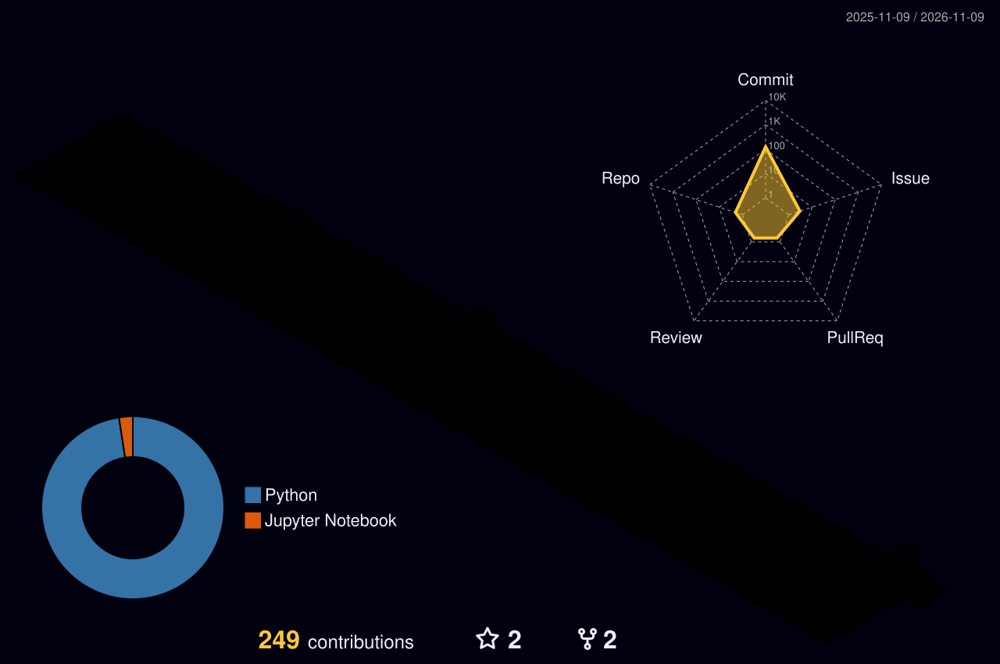

  

  
  

  

## 🧠 What I Work With

| Area | What I do |
|---|---|
| 🤖 **Machine Learning** | Building and evaluating predictive models |
| 🧠 **Deep Learning** | Neural networks and fine-tuning transformers |
| 💬 **NLP & LLMs** | Language understanding and LLM-powered apps |
| ✨ **Generative AI** | Apps that generate text, responses and insights |
| 📚 **RAG** | Grounded AI systems that cite and check their answers |
| 👁️ **Computer Vision** | Models that see and reason over images & video |
| 🚀 **Deployment** | Turning models into apps people can use |
| 📊 **Data & Analytics** | From raw data to insights and dashboards |

## 🔭 Currently Exploring

- 🦾 **Robotics**: how robots perceive, plan and act, and where AI fits in
- 🧩 **AI Agents**: systems that plan, use tools and check their own work
- ⚡ **Scaling LLMs**: deploying LLMs efficiently at scale

## 🛠️ Tech Stack

  

  
  
  
  
  
  

## 📈 GitHub Activity

  

  

## 🤖 Drive My Robot

Since I'm exploring robotics, here's a tiny robot that lives on my profile. **Anyone can drive it!** Click a button, then click **Create** on the issue that opens. A GitHub Action moves the robot 🤖 and updates this page in about a minute.
Steer around the rocks 🪨 and reach the battery 🔋 to charge it ⚡

<!--ROBOT_START-->

⬛⬛⬛⬛⬛⬛⬛⬛⬛ ⬛⬛🪨⬛⬛⬛⬛🪨⬛ ⬛🤖⬛⬛⬛⬛⬛⬛⬛ ⬛⬛⬛⬛🪨⬛🪨⬛⬛ ⬛⬛⬛⬛🔋⬛⬛⬛⬛

 

 

⚡ <b>Batteries charged:</b> 0 &nbsp;·&nbsp; 🕹️ <b>Total moves:</b> 3 &nbsp;·&nbsp; 👥 <b>Drivers:</b> 1

| Driver | Action | Date |
|---|---|---|
| [@MuraliKrishnaGR](https://github.com/MuraliKrishnaGR) | moved right | 2026-11-09 |
| [@MuraliKrishnaGR](https://github.com/MuraliKrishnaGR) | moved down | 2026-11-09 |
| [@MuraliKrishnaGR](https://github.com/MuraliKrishnaGR) | moved up | 2026-11-09 |
<!--ROBOT_END-->

## 🤝 Let's Connect

I'm always happy to talk about machine learning, LLMs, computer vision, robotics and interesting problems. Feel free to reach out!

  

  

